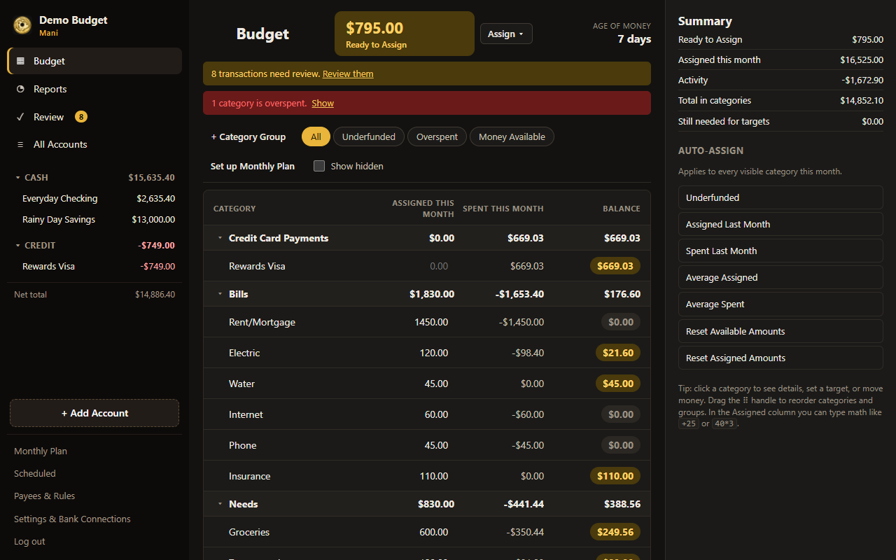
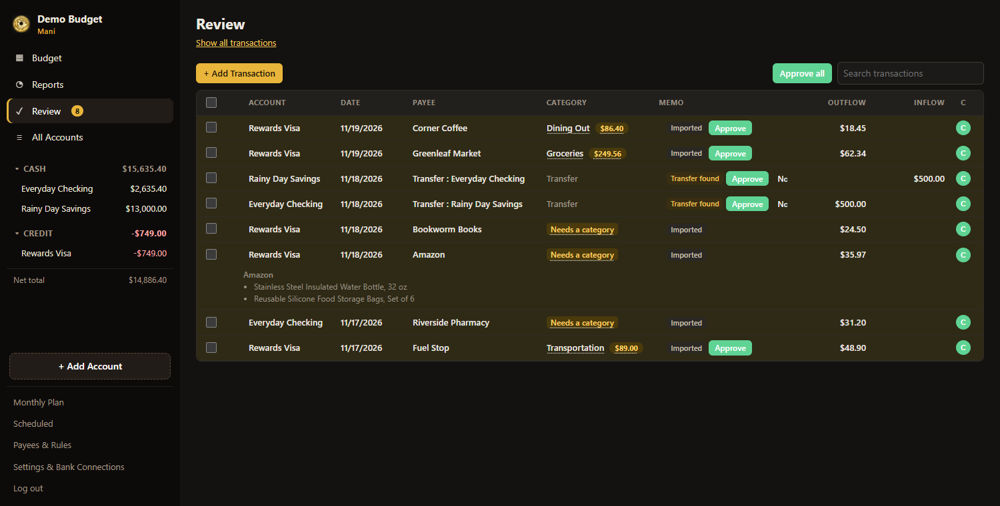
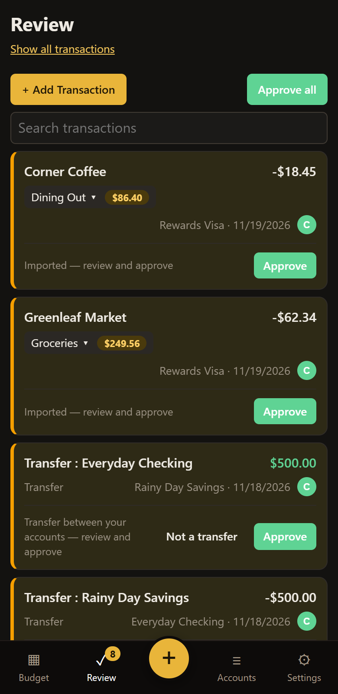

# Mani — self-hosted zero-based budgeting

*Lukautim mani* Named after the Tok Pisin word for money; the logo is the Papua New Guinea 1-kina coin (two saltwater crocodiles around the centre hole), shown in gold.

A self-hosted envelope (zero-based) budgeting app: give every dollar a job, roll money over month to month, and handle credit cards automatically. It can also import transactions from your banks and credit cards on its own.



| Review new transactions from every account in one list | The same list on a phone |
| --- | --- |
|  |  |

*Screenshots use made-up demo data.*

## Contents

- [Features](#features)
- [1. Run it locally](#1-run-it-locally)
- [2. Link your banks and credit cards](#2-link-your-banks-and-credit-cards)
- [3. Hosting: what you need and your options](#3-hosting-what-you-need-and-your-options)
  - [Reaching it from your phone with Tailscale](#reaching-it-from-your-phone-with-tailscale)
  - [Keep it running 24/7: Windows](#keep-it-running-247-on-windows-no-wsl) · [Mac](#keep-it-running-247-on-a-mac) · [Docker](#docker-mac-windows-or-linux) · [Windows with WSL](#keep-it-running-247-on-windows-with-wsl)
  - [Backups](#backups) · [Updating](#updating)
- [Using it on your phone](#using-it-on-your-phone)
- [Notifications for new transactions](#notifications-for-new-transactions)
- [Amazon purchases: the browser extension](#amazon-purchases-the-browser-extension)
- [Two-step login](#two-step-login)
- [Configuration reference](#configuration-reference-env)
- [Limitations](#limitations)
- [Project layout](#project-layout)

## Features

**Budget**
- Ready to Assign, with a breakdown: left over, income this month, last month's overspending, assigned now, assigned in future months
- Category groups and categories: add, rename, hide, move and delete (with reassignment)
- Assigned / Activity / Available columns. Positive balances roll over; negative ones reset to zero next month
- Cash overspending (red) is taken out of next month's Ready to Assign. Credit overspending (yellow) becomes card debt
- **Credit card payment categories**: spending from a funded category moves money into the card's payment category, refunds move it back, and a payment is a transfer from checking to the card
- Move money and cover overspending from the Available pill
- Targets: *set aside X a month*, *refill up to X*, *have a balance of X*, and *have X by a date*. Each shows a progress bar and how much more is needed
- Auto-Assign: Underfunded, Assigned Last Month, Spent Last Month, Average Assigned, Average Spent, Reset Available, Reset Assigned
- Age of Money
- The Assigned box accepts math: `100+25`, `40*3`, or `+20` to add to the current amount

**Accounts and transactions**
- Budget accounts (checking, savings, cash, credit card, line of credit) and tracking accounts (asset, liability, mortgage, loan)
- A register with cleared / uncleared / working balances, search, flags, bulk actions, and split transactions
- Transfers between any two accounts, kept in sync on both sides
- Reconcile: confirm or enter your bank's balance; an adjustment is created if they differ
- Scheduled and repeating transactions, entered automatically on their date
- Each payee remembers its last category. Import rules can rename messy bank descriptions and pick a category

**Auto import (Direct Import)**
- **SimpleFIN Bridge**: paste a token and you're connected. Easiest option for personal use
- **Plaid**: a widely used US bank aggregator. Opens the familiar bank-login popup
- Imported transactions wait for your **approval**. They are **auto-matched** to transactions you already typed in (same amount, within 10 days) and **de-duplicated**
- A new linked account gets a starting balance so it matches the bank exactly
- Imports run every N hours in the background, and whenever you press **Import** in the account
- **File import** (CSV with column mapping, OFX, QFX) for banks that aggregators don't support

**Reviewing what comes in**
- One **Review** list for every account: anything not yet approved or still missing a category
- Pick a category right in the list. A brief popup shows the category's balance before and after, with **Undo**
- **Transfers between your own accounts are detected** and joined automatically, so they don't need a category
- **Phone notifications** when new transactions arrive
- **Amazon purchases show what you bought**, using a small browser extension that reads your own order history

**Also included:** Reports (Spending, Net Worth, Income v Expense), password login, encrypted bank credentials, CSV export, one-click database backup, a phone-friendly layout, and dark mode.

---

## 1. Run it locally

You need **Node.js 20 or newer** (the current LTS release is best) and **git**. It runs on Linux, macOS and Windows.

### Linux and macOS

On a Mac, install Node with the installer from https://nodejs.org or with Homebrew (`brew install node`). git comes with Apple's command line tools (`xcode-select --install`).

```bash
git clone https://github.com/<you>/mani.git
cd mani
npm install
cp .env.example .env        # optional; edit time zone, Plaid keys, etc.
npm run build
npm start
```

### Windows (no WSL needed)

Install **Node.js LTS** from https://nodejs.org and **Git for Windows** from https://git-scm.com. Then, in PowerShell:

```powershell
git clone https://github.com/<you>/mani.git
cd mani
npm install
Copy-Item .env.example .env   # optional; edit time zone, Plaid keys, etc.
npm run build
npx tsx server/index.ts
```

On Windows, start the server with `npx tsx server/index.ts` instead of `npm start`, which uses Mac/Linux shell syntax. Every other `npm run …` command works as written.

If `npm install` fails while building `better-sqlite3`, you're probably on a very new or odd Node version with no ready-made build. Switch to the current Node LTS and run `npm install` again.

### First visit

Open **http://localhost:3000**. The first visit asks you to name the budget and set a password.

To work on the code with hot reload, run `npm run dev` and open http://localhost:5173. Run `npm test` for the budget-math test suite.

## 2. Link your banks and credit cards

In the app, click **+ Add Account → Linked**, or go to **Settings & Bank Connections → + Link a bank**. Both providers below are supported, and you can use both at the same time. The same steps are shown inside the app.

### Option A — SimpleFIN Bridge (recommended for personal use)

- Costs **$1.50/month or $15/year**, paid to SimpleFIN. That covers up to 25 institutions.
- No developer account, no keys, no HTTPS requirement.

Steps:

1. Sign up at **https://bridge.simplefin.org/simplefin/create**.
2. In SimpleFIN Bridge, add your institutions by logging in to each bank and card.
3. Create a **Setup Token** for a new app and copy it.
4. In Mani: **Add Account → Linked → SimpleFIN Bridge**. Paste the token and click **Connect**.
5. For each bank account, choose one of:
   - **New account**: pick its name and type
   - **Existing account**: link it to an account you already track by hand
   - **Don't import**

   Also choose the date to start importing from. Click **Import transactions**.
6. New transactions show up highlighted. Click **Approve** on each, or **Approve all**.

Notes:
- A setup token works only once. The app swaps it for a private access URL and stores that encrypted.
- SimpleFIN asks apps to make about 24 requests a day at most. The default of every 6 hours stays well inside that.

### Option B — Plaid

- Plaid's **Trial plan** for new teams is free and covers up to 10 real (Production) bank connections. Check your Plaid dashboard for your current limits.
- Requires a free developer account.

Steps:

1. Sign up at **https://dashboard.plaid.com/signup**.
2. Open **Developers → Keys** and copy your `client_id` and secret.
3. Add them to `.env`:
   ```
   PLAID_CLIENT_ID=xxxxxxxx
   PLAID_SECRET=xxxxxxxx
   PLAID_ENV=sandbox        # switch to production once you have Production access
   ```
4. Restart the server.
5. In Mani: **Add Account → Linked → Plaid → Connect with Plaid**.
   - In sandbox, log in with `user_good` / `pass_good` to get fake test data.
6. When sandbox works, request **Production** access in the Plaid dashboard. Set `PLAID_ENV=production` and the production secret, then restart.
7. Banks that use **OAuth** (Chase, Bank of America, Wells Fargo, Capital One, …) work without extra setup. Plaid opens the bank's own login page in a popup.
   - **Optional:** `PLAID_REDIRECT_URI` is only needed if you open the app inside an in-app browser or webview on a phone. To use it, add `https://YOUR-DOMAIN/oauth-return` under **Allowed redirect URIs** in the Plaid dashboard and set `PLAID_REDIRECT_URI` to the same value. It must be HTTPS.
   - Note: on the free Trial plan, removing a connection does **not** give back one of your 10 slots, and linking the same bank twice uses two. Use **Fix connection** instead of re-linking.
8. If a bank later asks you to log in again, the connection turns red in Settings. Click **Fix connection**.

### Testing Plaid in Sandbox first

Use a separate copy of the data so fake bank data never mixes with your real budget:

```bash
DATA_DIR=./data-sandbox PORT=3001 PLAID_ENV=sandbox npm start
```

- Log in to Plaid's fake banks with `user_good` / `pass_good`, or `user_transactions_dynamic` with any password for more realistic history.
- Force a "log in again" error to test **Fix connection**: `DATA_DIR=./data-sandbox PLAID_ENV=sandbox npm run plaid:sandbox -- reset-login <connectionId>`. Run `npm run plaid:sandbox -- list` (with the same settings) to see connection ids.
- Generate new transactions: `npm run plaid:sandbox -- refresh <connectionId>`, wait about 30 seconds, then press **Import**.

When you're done, delete `data-sandbox/`.

### Option C — File import

Open an account, click **File Import**, and choose a CSV, OFX or QFX file downloaded from your bank. Duplicates are skipped automatically.

### How imports behave

- Only **posted** transactions are imported. Pending ones arrive once they post.
- An imported transaction that matches one you entered (same account, same amount, within ±10 days) is **merged** with it and marked "Matched". If the match is wrong, use **Unmatch**.
- The category is filled in from your Payee rules (**Payees & Rules**) or from the category you last used for that payee.
- Approving a transaction, or editing and saving it, approves it.

## 3. Hosting: what you need and your options

The app is **one Node process plus one SQLite file** (`data/budget.db`). There's no separate database server or cloud account to set up.

Two things matter:

- **It must keep running** for automatic bank sync and scheduled transactions to happen. If it's off, it catches up the next time it starts.
- **Don't expose it to the open internet without HTTPS.** It holds your financial data. Using a private network such as Tailscale is the safest choice.

### Option 1 — Your own always-on computer plus Tailscale (recommended, free)

Use a mini PC, an old laptop, a Raspberry Pi 4/5, or a NAS that runs Docker.

1. Run the app there and keep it running. See below for Windows, Mac, Linux (the systemd unit in `deploy/mani.service`) or Docker.
2. Set the computer to **never sleep** while plugged in. A sleeping computer can't sync or answer your phone.
3. Set up Tailscale as described next, so your phone and laptop can reach it.

### Reaching it from your phone with Tailscale

[Tailscale](https://tailscale.com) (free for personal use) joins your own devices into a private network, wherever they are. Mani itself stays listening only on the computer it runs on; Tailscale gives it an HTTPS address that your other devices can open.

**Set it up once**

1. Install Tailscale on the computer that runs Mani **and** on your phone, and sign in to the same Tailscale account on both.
2. In the Tailscale admin console (https://login.tailscale.com/admin/dns), turn on **MagicDNS** and **HTTPS Certificates**.
3. On the computer that runs Mani, run:
   ```bash
   tailscale serve --bg 3000
   ```
   It prints your address, like `https://<machine>.<tailnet>.ts.net`. `--bg` makes it permanent: it survives restarts.
4. On your phone, make sure the Tailscale app is connected, open that address, and add it to your home screen (see [Using it on your phone](#using-it-on-your-phone)).
5. On Windows, open Tailscale's settings and turn on **Run unattended**, so it keeps working when nobody is signed in.

**Private or public: Serve vs Funnel**

| | `tailscale serve` (recommended) | `tailscale funnel` |
| --- | --- | --- |
| Who can open the address | Only devices signed in to your Tailscale account | Anyone on the internet |
| Needs the Tailscale app on your phone | Yes, and it must be connected | No, any browser works |
| What protects your budget | Tailscale, then your Mani password | Only your Mani password (and two-step login) |

- Check which one you have: `tailscale serve status`. If it says **Funnel on**, the address is public.
- Go back to private: `tailscale funnel reset`, then `tailscale serve --bg 3000`.
- If you choose Funnel, turn on [two-step login](#two-step-login) first and use a long password.

**Good to know**

- Notifications reach your phone either way, even when the Tailscale app is disconnected; you only need the connection to open the app.
- `tailscale serve` connects to `127.0.0.1:3000`, so leave `HOST=127.0.0.1` in `.env`. Only set `HOST=0.0.0.0` if you want to use the plain `http://<tailscale-ip>:3000` address without `serve` (no HTTPS, and no notifications or home-screen install, which need HTTPS).
- If the address stops working, check that Tailscale is running and connected on both devices, then run `tailscale serve status` on the computer.

### Keep it running 24/7 on Windows (no WSL)

A scheduled task starts Mani when Windows boots, even before anyone signs in, and restarts it if it stops. Run this in **PowerShell as administrator** from inside the `mani` folder. It doesn't need your Windows password, so it also works if you only sign in with a PIN or Windows Hello.

```powershell
New-Item -ItemType Directory -Force data\logs | Out-Null
$dir = (Get-Location).Path
$action = New-ScheduledTaskAction -Execute "cmd.exe" -Argument "/c npx tsx server/index.ts >> data\logs\mani.log 2>&1" -WorkingDirectory $dir
$trigger = New-ScheduledTaskTrigger -AtStartup
$settings = New-ScheduledTaskSettingsSet -AllowStartIfOnBatteries -DontStopIfGoingOnBatteries -StartWhenAvailable -ExecutionTimeLimit ([TimeSpan]::Zero) -RestartCount 999 -RestartInterval (New-TimeSpan -Minutes 1)
$principal = New-ScheduledTaskPrincipal -UserId "$env:USERDOMAIN\$env:USERNAME" -LogonType S4U -RunLevel Limited
Register-ScheduledTask -TaskName "Mani budget" -Action $action -Trigger $trigger -Settings $settings -Principal $principal
Start-ScheduledTask "Mani budget"
```

Then open http://localhost:3000. The log is in `data\logs\mani.log`. If the server crashes, the task tries to start it again every minute.

- **Other devices on your Wi-Fi:** set `HOST=0.0.0.0` in `.env`, restart the task (`Stop-ScheduledTask "Mani budget"`, then `Start-ScheduledTask "Mani budget"`), and allow the port through the firewall:
  ```powershell
  New-NetFirewallRule -DisplayName "Mani budget (port 3000)" -Direction Inbound -Protocol TCP -LocalPort 3000 -Action Allow -Profile Private
  ```
- **From anywhere:** follow [Reaching it from your phone with Tailscale](#reaching-it-from-your-phone-with-tailscale). In Tailscale's settings, turn on **Run unattended** so it keeps working when you're signed out.
- **Stop:** `Stop-ScheduledTask "Mani budget"`. **Turn off auto-start:** `Disable-ScheduledTask "Mani budget"`.
- **After updating** (see *Updating* below), run `npm run build` and then restart the task.

### Keep it running 24/7 on a Mac

macOS's built-in `launchd` starts Mani when you log in and restarts it if it stops. From inside the `mani` folder, run:

```bash
mkdir -p data/logs ~/Library/LaunchAgents
cat > ~/Library/LaunchAgents/com.mani.budget.plist <<EOF
<?xml version="1.0" encoding="UTF-8"?>
<!DOCTYPE plist PUBLIC "-//Apple//DTD PLIST 1.0//EN" "http://www.apple.com/DTDs/PropertyList-1.0.dtd">
<plist version="1.0">
<dict>
  <key>Label</key><string>com.mani.budget</string>
  <key>ProgramArguments</key>
  <array><string>/bin/zsh</string><string>-lc</string><string>exec npm start</string></array>
  <key>WorkingDirectory</key><string>$(pwd)</string>
  <key>RunAtLoad</key><true/>
  <key>KeepAlive</key><true/>
  <key>StandardOutPath</key><string>$(pwd)/data/logs/mani.log</string>
  <key>StandardErrorPath</key><string>$(pwd)/data/logs/mani.log</string>
</dict>
</plist>
EOF
launchctl load -w ~/Library/LaunchAgents/com.mani.budget.plist
```

Then open http://localhost:3000.

- It runs while you're logged in. To have it start after a power cut without anyone at the keyboard, turn on automatic login: **System Settings → Users & Groups**.
- **Stop sleep:** in **System Settings → Battery** (or **Energy** on a desktop Mac), turn on *Prevent automatic sleeping when the display is off*.
- **Other devices on your Wi-Fi:** set `HOST=0.0.0.0` in `.env`, restart (below), and open `http://<your-mac-name>.local:3000`. Allow incoming connections for `node` if the firewall asks.
- **From anywhere:** follow [Reaching it from your phone with Tailscale](#reaching-it-from-your-phone-with-tailscale).
- **Restart:** `launchctl kickstart -k gui/$(id -u)/com.mani.budget`. **Stop and turn off auto-start:** `launchctl unload -w ~/Library/LaunchAgents/com.mani.budget.plist`.

### Docker (Mac, Windows or Linux)

If you'd rather use **Docker Desktop**, run this from the `mani` folder:

```bash
cp .env.example .env
docker compose up -d --build
```

The container restarts on its own (`restart: unless-stopped`). Turn on *Start Docker Desktop when you sign in* in Docker Desktop's settings. Your data is kept in `./data`. The app is only reachable from the computer itself, at http://localhost:3000. To reach it from your phone, use `tailscale serve --bg 3000`.

### Keep it running 24/7 on Windows with WSL

If you already run the app inside WSL, `deploy/start-mani.sh` starts Mani and restarts it within seconds if it ever stops. It logs to `data/logs/mani.log`. WSL shuts down when it's idle unless something is running in it, so start it from a scheduled task at boot. Run this in **PowerShell as administrator**. Replace `<distro>`, `<user>` and the path with your own; `wsl -l -v` lists your distros.

```powershell
$action = New-ScheduledTaskAction -Execute "C:\Windows\System32\wsl.exe" -Argument "-d <distro> -u <user> -- bash /home/<user>/mani/deploy/start-mani.sh"
$trigger = New-ScheduledTaskTrigger -AtStartup
$settings = New-ScheduledTaskSettingsSet -AllowStartIfOnBatteries -DontStopIfGoingOnBatteries -StartWhenAvailable -ExecutionTimeLimit ([TimeSpan]::Zero) -RestartCount 999 -RestartInterval (New-TimeSpan -Minutes 1)
$principal = New-ScheduledTaskPrincipal -UserId "$env:USERDOMAIN\$env:USERNAME" -LogonType S4U -RunLevel Limited
Register-ScheduledTask -TaskName "Mani budget" -Action $action -Trigger $trigger -Settings $settings -Principal $principal
```

**Port forwarding (WSL).** Mani listens privately on port 3001 (`HOST=127.0.0.1`, `PORT=3001` in `.env`), and a Windows port-forwarding rule publishes it as port 3000. If WSL uses mirrored networking, Mani and the forwarding rule can't both use port 3000. In admin PowerShell:

```powershell
netsh interface portproxy add v4tov4 listenport=3000 listenaddress=127.0.0.1 connectport=3001 connectaddress=127.0.0.1
```

That is all Tailscale needs (`tailscale serve --bg 3000` connects to `127.0.0.1:3000`), and nothing else on your network can reach the app.

Only if you also want to open `http://<computer's LAN IP>:3000` from other devices on your Wi-Fi, use `listenaddress=0.0.0.0` instead and allow the port through the firewall. That traffic is plain, unencrypted HTTP, and every device on the network can reach the login page:

```powershell
New-NetFirewallRule -DisplayName "Mani budget (port 3000)" -Direction Inbound -Protocol TCP -LocalPort 3000 -Action Allow -Profile Private
```

Also turn on Tailscale's **Run unattended** if you use Tailscale on Windows. To stop: `Stop-ScheduledTask "Mani budget"`; to turn off auto-start: `Disable-ScheduledTask "Mani budget"`.

### Option 2 — A small VPS (about $4–6/month)

Hetzner, DigitalOcean, Linode and Vultr all work. 1 vCPU and 1 GB RAM is plenty.

```bash
# on the server (Ubuntu), after installing Docker:
git clone <your copy of this repo> mani && cd mani
cp .env.example .env && nano .env      # set TZ, Plaid keys, etc.
docker compose up -d --build
```

Then add HTTPS:
- Point a domain's DNS at the server.
- Install **Caddy** and use `deploy/Caddyfile` (change the domain). Caddy gets and renews the HTTPS certificate automatically.

The compose file binds the app to `127.0.0.1` only, so the only way in from outside is through Caddy.

Alternatives:
- **Cloudflare Tunnel** gives you HTTPS without opening any ports.
- **Fly.io** or **Railway** work too: mount a persistent volume at `/data`.

### Backups

Use **Settings → Download full backup**, or copy the `data/` folder. Keep these two files together:
- `data/budget.db`: your data
- `data/secret.key`: needed to decrypt the bank links

If you lose the key, your budget data is fine; you only need to re-link your banks.

### Updating

```bash
git pull
npm install && npm run build
# then restart: npm start, or docker compose up -d --build
```

The database schema is created and updated automatically.

## Using it on your phone

On phones the app switches to a touch layout:
- **Bottom tab bar:** Budget, Review, **+** (add a transaction), Accounts, Settings.
- **Transactions as cards:** tap **Needs a category ▾** to pick a category from a searchable list that shows each balance. Picking a category also approves the transaction. Tap a card to edit it in a full-screen form.
- **Categories:** tap one on the Budget screen to see its details, targets and Auto-Assign.

To open it on your phone, the phone must be able to reach the server:
- **Tailscale (recommended):** works from anywhere over HTTPS. Follow [Reaching it from your phone with Tailscale](#reaching-it-from-your-phone-with-tailscale).
- **Same Wi-Fi only:** set `HOST=0.0.0.0` in `.env`, restart, and open `http://<computer's LAN IP>:3000`. On WSL you'll also need Windows port forwarding, so Tailscale is easier. Notifications and installing to the home screen need HTTPS, so they won't work this way.

Then add it to your home screen so it opens full screen like an app:
- **iPhone:** in Safari, tap Share → **Add to Home Screen**.
- **Android:** in Chrome, tap ⋮ → **Add to Home screen** (or **Install app**).

## Notifications for new transactions

Mani can notify your phone whenever a bank import brings in new transactions, so you can categorize them right away. Tapping the notification opens the Review list.

1. Open Mani on the phone over its **HTTPS** address (the Tailscale one). On an iPhone, add it to the home screen first and open it from there.
2. Go to **Settings → Notifications**, turn them on, and allow notifications when the phone asks.
3. Press **Send a test** to check it arrives.

Notifications are sent straight from your server through the phone maker's push service (Google or Apple), encrypted so only your phone can read them. Each phone or browser is listed in Settings and can be removed there.

## Amazon purchases: the browser extension

Banks only report "Amazon" and an amount. The **Mani Amazon** extension (in `amazon-extension/`) reads your own Amazon order history in your browser and sends it to your own Mani, so each Amazon charge shows what was bought.

**How it works**

1. The extension runs in a browser where you are signed in to Amazon. Every 3 hours, and whenever you press **Sync now**, it reads two of your Amazon pages: **Your Payments → Transactions** (each card charge with its order number) and **Your Orders** (what each order contained).
2. It sends that list to your Mani server, signing in with a token you create in Mani. Nothing goes anywhere else, and Mani never sees your Amazon password.
3. Mani matches each Amazon charge to the bank transaction with the same amount around the same date (and the same card, when Amazon shows the last four digits). When an order was charged in several parts, each part is matched separately.
4. Matched transactions show the full item names in the Review list and the transaction editor, with a link to the order on Amazon.

**Set it up**

1. In Mani, open **Settings → Amazon** and create a token. It is shown once; copy it.
2. Build the extension: `npm run extension` (needs Python 3). This creates `amazon-extension/dist/`.
3. Load it in your browser:
   - **Chrome or Edge:** open `chrome://extensions`, turn on **Developer mode**, press **Load unpacked** and choose `amazon-extension/dist/chrome`.
   - **Firefox, to try it:** open `about:debugging` → **This Firefox** → **Load Temporary Add-on** and choose `amazon-extension/dist/firefox/manifest.json`. This lasts until Firefox closes.
   - **Firefox, permanently:** upload `amazon-extension/dist/mani-amazon-firefox.zip` at https://addons.mozilla.org/developers as an add-on distributed **on your own**. Mozilla signs it, usually within minutes, and gives you an `.xpi` file to install.
4. Open the extension's settings, paste Mani's address (the same one you open in the browser) and the token, and save. If the small popup closes while you copy things, use its **open these settings in a tab** link.
5. Make sure you're signed in to amazon.com in that browser, then press **Sync now**.

**Good to know**

- It only syncs while that browser is open and signed in to Amazon. It catches up the next time the browser runs; nothing is lost, only delayed.
- To look less like a robot to Amazon, it reads slowly and stops as soon as it reaches orders Mani already has. Once a week it re-reads the whole look-back period (60 days by default) in case something was missed.
- In Firefox, it reads older pages by briefly opening an Amazon tab in the background and closing it again. Chrome reads the first page of charges only, and fills in older ones from your order list as estimates.
- Amazon changes its pages from time to time. If reading stops working, **Settings → Amazon** shows the last error.
- Only amazon.com (US) is supported.
- To disconnect, revoke the token in **Settings → Amazon** and remove the extension.

## Two-step login

Turn it on in **Settings → Security → Set up two-step login**: scan the QR code with an authenticator app (Google Authenticator, Microsoft Authenticator, Authy, 1Password…), enter the code, and save the 10 recovery codes. Logging in then needs your password plus the 6-digit code, or one recovery code (each works once). Turn this on before making the app reachable from the internet.

Locked out? Run these on the computer that hosts the app; both sign out every device:

```bash
npm run auth -- disable-2fa
```
```bash
npm run auth -- reset-password
```

## Configuration reference (`.env`)

| Variable | Default | Purpose |
|---|---|---|
| `HOST` / `PORT` | `127.0.0.1` / `3000` | Listen address |
| `DATA_DIR` | `./data` | Location of the database and key |
| `TZ` | system | Your time zone, used for "today" and scheduled transactions |
| `SYNC_INTERVAL_HOURS` | `6` | Hours between automatic bank syncs (`0` = off; also settable in Settings) |
| `ENCRYPTION_KEY` | auto | Encrypts bank tokens. If unset, a key is generated in `data/secret.key` |
| `TRUST_PROXY` | `loopback` | Set to `1` behind a reverse proxy on another host or in Docker |
| `PLAID_CLIENT_ID`, `PLAID_SECRET` | — | Plaid keys |
| `PLAID_ENV` | `sandbox` | `sandbox` or `production` |
| `PLAID_COUNTRY_CODES` | `US` | Comma list, e.g. `US,CA` |
| `PLAID_REDIRECT_URI` | — | Optional `https://…/oauth-return`; only needed for in-app browsers or webviews |

## Limitations

- One user and one budget per install. Run a second copy with a different `DATA_DIR` and `PORT` for a second budget.
- Targets have 4 types; there are no weekly or custom-cadence targets.
- No special loan-account categories. Loans are tracking accounts; pay them with a categorized transfer.
- Split transactions can't include a transfer line.
- No undo button and no drag-and-drop reordering; move categories between groups from the category panel.
- Bank sync polls on a timer instead of using Plaid webhooks.

## Project layout

```
server/      Express API, SQLite schema, budget engine (budget.ts), bank sync (banks.ts), tests
client/      React UI (Vite)
shared/      Date/money helpers used by both sides
deploy/      Caddyfile and systemd unit
amazon-extension/   Browser extension that sends your Amazon order details to Mani
docs/        Screenshots
```
